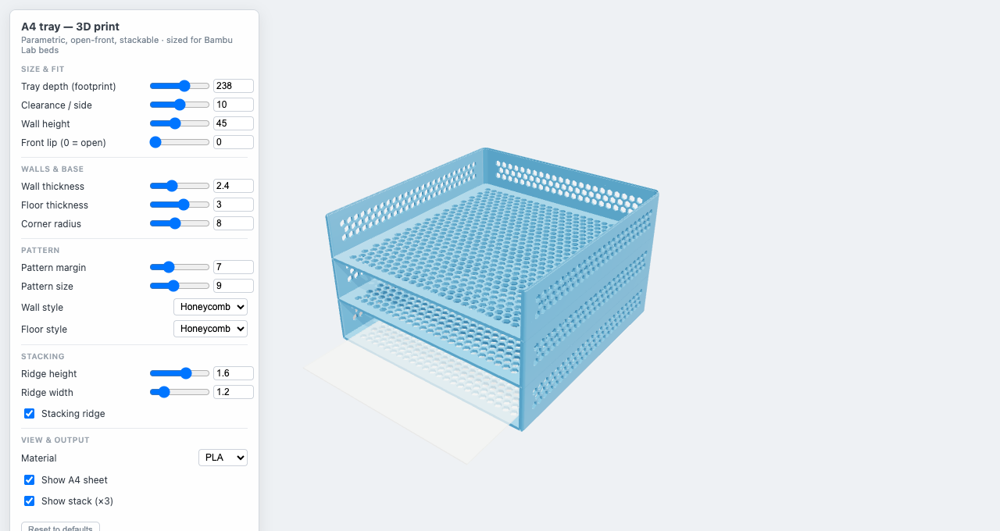

# a4-stackable-trays

Parametric, open-front, **stackable A4 paper trays** for FDM 3D printing. Tune everything with
sliders, watch the model and the filament estimate update live, then export a print-ready STL.
The preview and the STL come from the _same_ geometry, so the print matches what you see.



## Why

A 3D-printed alternative to the laser-cut plywood version — better looking, lighter, and it
nests. Trays hold ~80% of the sheet and leave the front open, so paper overhangs where you grab
it and stays reachable while stacked. Holding only part of the sheet also shrinks the footprint
so it fits smaller beds.

## What you get

- **Open front** — sheet overhangs and stays accessible while stacked (`Front lip = 0` removes
  the front wall _and_ the floor under it, for tighter bed fitment).
- **Stackable** — a chamfered ridge on the wall tops drops into a funnel groove in the floor
  above, so trays self-register when nested. Both are tapered to print without support.
- **7 wall + floor styles** — solid, louvres, grid, holes, diamond, honeycomb, voronoi — to cut
  weight and filament. A honeycomb wall+floor roughly halves the mass.
- **Live filament estimate** in grams and metres of 1.75 mm filament (PLA / PETG / ABS / TPU).
- **Bambu Lab fit badges** — shows at a glance which beds the current footprint fits
  (A1 mini · A1/X2D · P1/P2/X1 · H2D/H2C · A2L · H2S — current 2026 lineup, grouped by bed),
  accounting for 90° rotation. Amber means it fits only with the P1/P2/X1 filament-cutter
  [exclusion-zone mod](https://wiki.bambulab.com/en/knowledge-sharing/print-volume-limitations).
- **One-click binary STL export.**

## Run

```bash
vp install      # or: pnpm install
vp dev          # http://localhost:5173
vp build        # production build
vp check        # format + lint + typecheck
```

## Controls

Grouped in the panel: **Size & fit** (footprint, clearance, front lip) ·
**Walls** (height, thickness, corner radius, style, pattern size + margin) ·
**Floor** (thickness, style, pattern size + margin) · **Stacking** (ridge height/width, on/off) ·
**View & output** (material, show sheet, show stack). Walls and floor each have their own pattern
size and margin, since the same margin reads very differently on a tall wall vs. the flat base.

## How it works

- `src/params.ts` — pure parameter types, defaults, and derived dimensions.
- `src/printers.ts` — Bambu bed table (grouped by size) and the bed-fit / exclusion-zone-mod logic.
- `src/csg.ts` — the solid-modelling layer: 2D profiles extruded and boolean'd through
  [manifold-3d](https://github.com/elalish/manifold) (Google's Manifold kernel — the engine modern
  OpenSCAD uses), which **guarantees watertight, 2-manifold output** so the STL slices cleanly.
- `src/tray.ts` — `Params → one watertight BufferGeometry`, modelled **Z-up, base on z = 0,
  millimetres** (slicer convention).
- `src/viewer/` — `main.ts` wires it together; `scene.ts` (renderer/camera/lights, renders on
  demand), `readout.ts` (volume estimate + fit badges), `controls.ts` (the slider panel), and
  `storage.ts` (localStorage persistence).

Your settings are saved in the browser and restored on the next visit; **Reset to defaults** clears
them.

## Printing

Print **base-down, no supports**. Every opening is vertical or cellular so its top only bridges a
short span; honeycomb/diamond/holes are self-supporting, and the stacking ridge/groove are tapered.
Floor patterns are vertical through-holes in a flat plate, so they need no bridging.

## Stack

Vanilla TypeScript + [Vite+](https://viteplus.dev) · Three.js · manifold-3d (WASM CSG) · d3-delaunay (voronoi).
